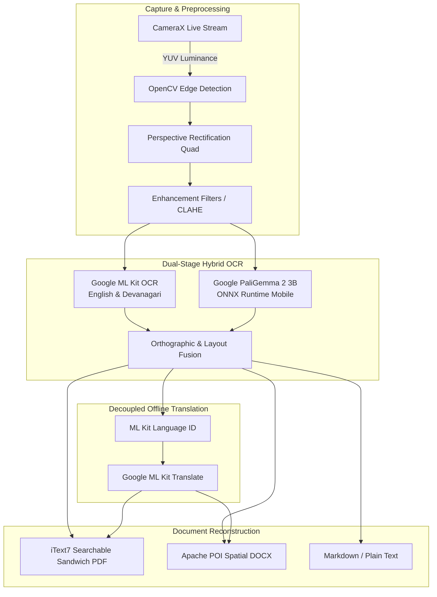

# Android-Scan-and-OCR-Demo
This is a scanning  and optical character recognition  being developed specifically for Devanagari script languages.
# ScanOCR 📄🔍

[-3DDC84.svg?logo=android&logoColor=white)](https://developer.android.com)
[-34A853.svg)](https://developer.android.com)
[](https://developer.android.com)
[](https://kotlinlang.org)
[](https://developer.android.com/jetpack/compose)
[](https://developer.android.com/16kb-page-size)
[](https://developers.google.com/ml-kit)
[-EA4335.svg)](https://huggingface.co/google/paligemma2-3b-pt-224)

**ScanOCR** is an enterprise-grade on-device document scanner, high-precision Optical Character Recognition (OCR), and document reconstruction Android application. Designed specifically for English and Indic scripts (Devanagari, Hindi, Marathi, Sanskrit), it fuses high-speed Google ML Kit recognition with Google's state-of-the-art **PaliGemma 2 (3B)** Vision-Language Model (VLM) for deep layout segmentation, while strictly keeping translation offline via Google ML Kit.

---

## ✨ Key Features

### 📷 1. Real-Time Camera & Document Rectification
- **Zero-Allocation Viewfinder**: CameraX frame analysis streaming `YUV_420_888` luminance buffers directly into native OpenCV without per-frame heap allocations.
- **Dynamic Quad Tracking**: Multi-strategy contour analysis, convex hull approximation, and geometric aspect-ratio scoring to locate document edges with millisecond latency.
- **Perspective Warping**: Interactive 4-corner perspective rectification matrix transforming skewed captures into flat, orthogonal documents.

### 🎨 2. Non-Destructive Image Enhancement Filters
Six Adobe Scan style enhancement filters optimized with native OpenCV SIMD acceleration and JVM fallbacks:
1. **Original**: Unmodified camera color and luminance.
2. **Magic Color**: Lab color space CLAHE (Contrast Limited Adaptive Histogram Equalization) whitening background paper while preserving vibrant ink pigments.
3. **Enhanced**: High-contrast S-curve Lookup Table (LUT) with dark ink crush and paper whitening.
4. **Black & White**: Gaussian noise reduction followed by adaptive binary Gaussian thresholding.
5. **Grayscale**: Contrast-equalized monochrome conversion with Laplacian edge sharpening.
6. **Vivid Color**: Saturation boost and linear contrast expansion for color documents and photographs.

### 🧠 3. Dual-Stage Hybrid OCR Architecture
- **Stage 1: Offline Google ML Kit Engine**:
  - Sub-second recognition for Latin/English and Devanagari scripts (`com.google.mlkit:text-recognition-devanagari`).
  - Hierarchical bounding box extraction (Blocks -> Lines -> Elements -> Symbols).
- **Stage 2: Google PaliGemma 2 (3B) VLM**:
  - Quantized INT4 ONNX Runtime Mobile execution for deep Indic layout analysis, multi-column reading order resolution, and complex script understanding.
  - Zero cloud dependency: runs entirely on-device on modern smartphones with 8 GB+ RAM.

### 🌐 4. Decoupled Offline Machine Translation
- **Strict Role Separation**: Neural translation is decoupled from OCR and handled exclusively by Google ML Kit Translation (`com.google.mlkit:translate`).
- Automatic source language identification via `com.google.mlkit:language-id`.
- Offline model downloading and bidirectional English <-> Hindi/Indic translation without sending sensitive documents to external servers.

### 📄 5. Multi-Format Spatially-Accurate Document Reconstruction
- **Searchable Sandwich PDF**: Generated via **iText7 Android**, embedding an invisible, selectable, searchable OCR text layer precisely aligned over the high-resolution scanned image.
- **Spatially-Accurate Microsoft Word (`.docx`)**: Constructed via **Apache POI OOXML** and **Aalto XML**, reconstructing multi-column paragraphs, tables, font stylings, and exact page layouts.
- **Markdown & Plain Text**: Clean, structured exports preserving headings, lists, and tabular formatting.
- **Scanned Gallery**: Interactive page reordering, rotation, deletion, and bulk export.

### ⚡ 6. Android 15+ 16 KB Page Size Compliant
Fully compliant with Google Play's 16 KB page size mandate for Android 15+ (API 35+) on 64-bit devices (`arm64-v8a` and `x86_64`). Every native shared library (`.so`) is verified with `align 2**14` ($16,384$ bytes) ELF LOAD segment boundaries:
- `androidx.camera` 1.4.1
- `org.opencv:opencv` 4.12.0
- `com.microsoft.onnxruntime:onnxruntime-android` 1.22.0
- `com.google.mediapipe:tasks-genai` 0.10.35

---

## 🏗️ Architecture Overview



---

## 📁 Project Structure

```
ScanOCR/
├── app/
│   ├── src/
│   │   ├── main/
│   │   │   ├── AndroidManifest.xml
│   │   │   ├── java/com/example/scanocr/
│   │   │   │   ├── MainActivity.kt                 # Application entry point & permission flow
│   │   │   │   ├── CameraViewModel.kt              # Camera capture & image processing coordinator
│   │   │   │   ├── ImageProcessor.kt               # OpenCV native quad detection & 6 filter presets
│   │   │   │   ├── OcrService.kt                   # Dual-engine OCR coordinator (ML Kit + PaliGemma 2)
│   │   │   │   ├── TranslationService.kt           # ML Kit neural translation (decoupled from OCR)
│   │   │   │   ├── LanguageDetector.kt             # ML Kit offline language identification
│   │   │   │   ├── PdfGenerationService.kt         # iText7 searchable sandwich PDF generator
│   │   │   │   ├── ScannedPageData.kt              # In-memory scanned page model
│   │   │   │   ├── DocumentQuadGeometry.kt         # Geometric quadrilateral math utilities
│   │   │   │   ├── DocumentImportService.kt        # Gallery image import & EXIF orientation fixer
│   │   │   │   ├── ai/
│   │   │   │   │   ├── AiModelType.kt              # PALIGEMMA_2_3B configuration & metadata
│   │   │   │   │   ├── AiModelManager.kt           # On-device model file management & download tracking
│   │   │   │   │   ├── AiInferenceService.kt       # ONNX Runtime & LiteRT VLM inference pipeline
│   │   │   │   │   ├── AiRuntimeFramework.kt       # Framework selection (ONNX Runtime / LiteRT)
│   │   │   │   │   └── ProcessingEngine.kt         # Engine modes (Google ML Kit vs. Hybrid PaliGemma)
│   │   │   │   ├── conversion/
│   │   │   │   │   ├── IndicBlockOcrEngine.kt      # Block OCR segmentation
│   │   │   │   │   ├── IndicDocLayoutEngine.kt     # Deep document layout analysis
│   │   │   │   │   ├── IndicOrthographicCorrector.kt # Devanagari Unicode normalization & lexicon validation
│   │   │   │   │   ├── HindiLexicon.kt             # Embedded Devanagari dictionary lookup
│   │   │   │   │   ├── LayoutBoundingBox.kt        # Spatial geometry primitives
│   │   │   │   │   └── PdfLayoutReconstructor.kt   # Apache POI DOCX & structural layout constructor
│   │   │   │   ├── ui/
│   │   │   │   │   ├── ScanScreen.kt               # Jetpack Compose live viewfinder & HUD
│   │   │   │   │   ├── ScannedPagesReviewScreen.kt # Review, crop, filter preview, and reorder UI
│   │   │   │   │   ├── FormatAccurateDocumentViewerScreen.kt # Multi-format document inspector
│   │   │   │   │   ├── GalleryScreen.kt            # Saved documents manager
│   │   │   │   │   ├── AiModelSetupDialog.kt       # PaliGemma 2 (3B) download & runtime configuration
│   │   │   │   │   └── theme/                      # Material 3 typography, colors, and styling
│   │   │   └── res/                            # Vector drawables, themes, and XML configurations
│   │   └── test/                               # JVM JUnit 4 unit tests (48 tests passing)
│   └── build.gradle.kts                        # App module dependencies & packaging rules
├── gradle/
│   └── libs.versions.toml                      # Gradle Version Catalog
├── build.gradle.kts                            # Root build script
├── settings.gradle.kts                         # Module settings & repository declarations
├── ARCHITECTURE.md                             # Deep architectural specification
└── CONTRIBUTING.md                             # Code standards & contribution guidelines
```

---

## 🚀 Getting Started

### Prerequisites
- **Android Studio**: Ladybug (2024.2+) or Meerkat (2024.3+)
- **JDK**: Java 17 or Java 21 (bundled Android Studio JBR recommended)
- **Android SDK**: `compileSdk = 37`, `minSdk = 26`, `targetSdk = 33`
- **Android NDK**: NDK `r28` or higher (tested with NDK `30.0.16248370`)
- **Recommended Device**: 64-bit device (`arm64-v8a`) or emulator (`x86_64`) with at least 8 GB of RAM for local Google PaliGemma 2 (3B) inference.

### Building from Source

1. **Clone the repository**:
   ```bash
   git clone https://github.com/fissionmallied14-prog/ScanOCR.git
   cd ScanOCR
   ```

2. **Build the Debug APK**:
   ```bash
   ./gradlew assembleDebug
   ```

3. **Run Unit Tests**:
   ```bash
   ./gradlew testDebugUnitTest
   ```

4. **Install onto Device/Emulator**:
   ```bash
   adb install -r app/build/outputs/apk/debug/app-debug.apk
   ```

---

## 🤖 Google PaliGemma 2 (3B) Setup

To use the advanced AI OCR and layout parsing features:
1. Open ScanOCR on your device.
2. Tap the **AI Engine** icon in the top app bar.
3. Select **Google PaliGemma 2 (3B)**.
4. Tap **Download Model**: The app will download and verify the INT4 quantized ONNX model weights (`paligemma2-3b-pt-224-q4.onnx`, ~1.63 GB) directly into the app's secure internal storage.
5. Once marked **Ready**, toggle the engine switch to enable PaliGemma 2 assisted OCR and deep layout analysis alongside Google ML Kit.

---

## 🛡️ 16 KB Page Size Verification

Google Play requires all apps submitted targeting Android 15+ to support 16 KB memory page sizes. You can verify ELF LOAD segment alignment of all bundled native libraries using `llvm-objdump`:

```bash
llvm-objdump -p <extracted_library.so> | Select-String "LOAD"
```

All 11 bundled libraries in ScanOCR have been verified with `align 2**14` ($0x4000$ = 16,384 bytes):
- `libandroidx.graphics.path.so`
- `libc++_shared.so`
- `libimage_processing_util_jni.so`
- `liblanguage_id_l2c_jni.so`
- `libllm_inference_engine_jni.so`
- `libmlkit_google_ocr_pipeline.so`
- `libonnxruntime.so`
- `libonnxruntime4j_jni.so`
- `libopencv_java4.so`
- `libsurface_util_jni.so`
- `libtranslate_jni.so`

---

## 📄 License

This project is licensed under the Apache License 2.0 - see the [LICENSE](LICENSE) file for details.
